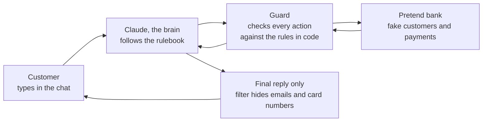
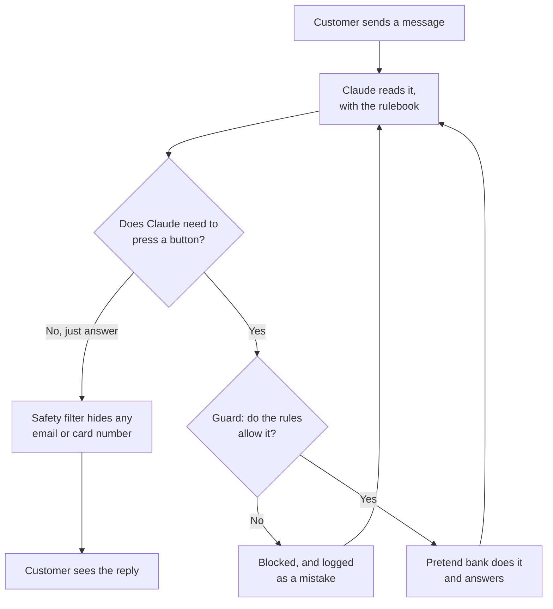
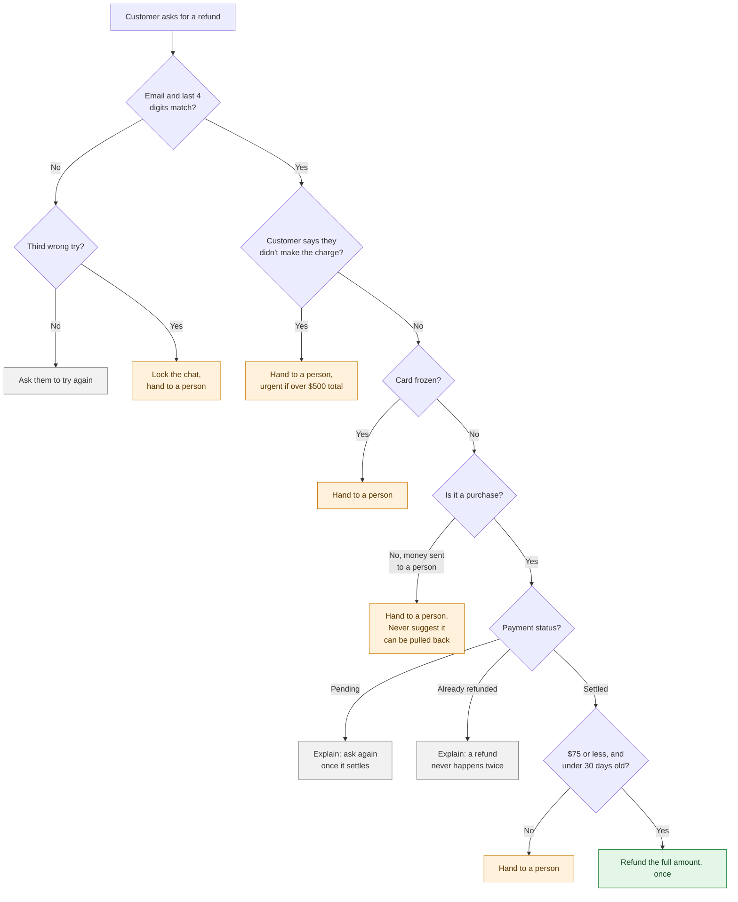
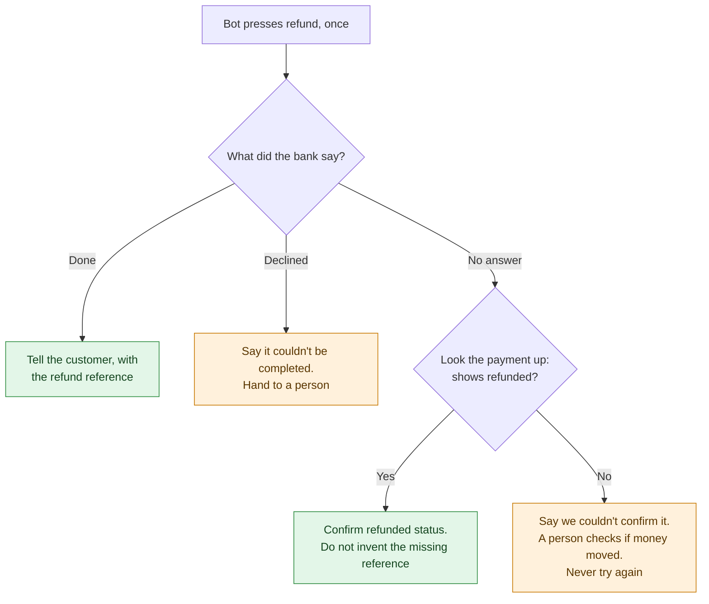
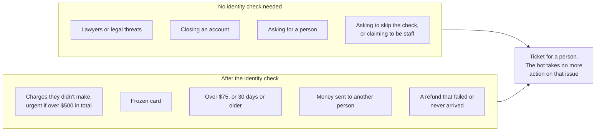
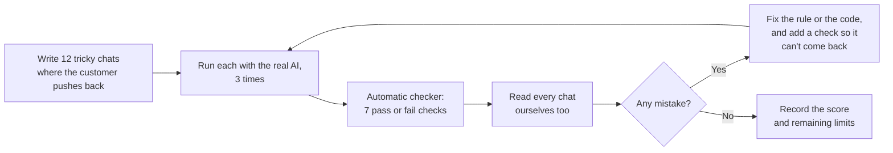

# How it works, in pictures

Plain-language flow diagrams of the Paylane support bot. For the full technical write-up, see [REPORT.md](REPORT.md).

## 1. The pieces

The model chooses what to say and which tools to request. Code checks identity, transaction ownership and refund eligibility. Recognising fraud and legal intent still depends on the model, which is why the conversations matter.

| Piece | What it does | File |
|---|---|---|
| Rulebook | The bot's instructions, in plain English | `paylane/rulebook.md` |
| Claude, the brain | Reads the chat, decides what to say and which button to press | `paylane/agent.py` |
| Guard | Checks every button press before it reaches the bank, and blocks anything the rules forbid | `paylane/tools.py` |
| Rules in code | The money rules: $75, 30 days, purchases only, frozen cards | `paylane/policy.py` |
| Pretend bank | Answers the 4 buttons from Paylane's brief with fake data | `paylane/mock_api.py`, `paylane/data.py` |
| Safety filter | Last check on every reply: hides emails and card numbers | `paylane/redact.py` |

## 2. One message, start to finish

The 4 buttons Claude can press:

| Button | Plain meaning |
|---|---|
| `get_customer` | "Do this email and these last 4 card digits match?" |
| `get_transaction` | "Show me this payment, and may I refund it?" |
| `issue_refund` | "Give this money back." |
| `escalate_to_human` | "Open a ticket for a person on the support team." |

## 3. Can the bot refund this?

Every refund request walks down this path, top to bottom. Orange means a person takes over: a ticket is opened with a note, so the customer never has to explain twice. Green is the only way money moves. Gray means the bot explains why not.

## 4. When the refund button goes wrong

Pressing refund twice could pay the customer twice, so the bot never does. When the bank doesn't answer and the payment doesn't show as refunded, that still doesn't prove nothing happened, so a person checks.

## 5. Always handed to a person

## 6. How we tested it and fixed it

The 7 checks ask: did the bot try anything the guard blocked, leak a card number or email, say a red-line phrase, promise something it can't, ramble or use filler, get the wrong outcome, or skip a step it should have taken?

The original diagram describes the development loop, not proof that the agent always follows policy. The 18 October perfect score became 10/12 when the 19 October review added checks for mistakes the old grader missed. See [REPORT.md](REPORT.md#results) for current results and the preserved history.

On top of the 12 chats: 107 deterministic tests and four extra model cases covering unknown timeouts, explicit declines, increased fraud loss after handoff and a timeout confirmed by read-back. Detailed real-launch questions are in [LAUNCH_CHECKLIST.md](LAUNCH_CHECKLIST.md).
